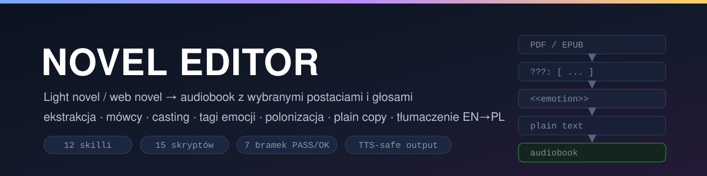
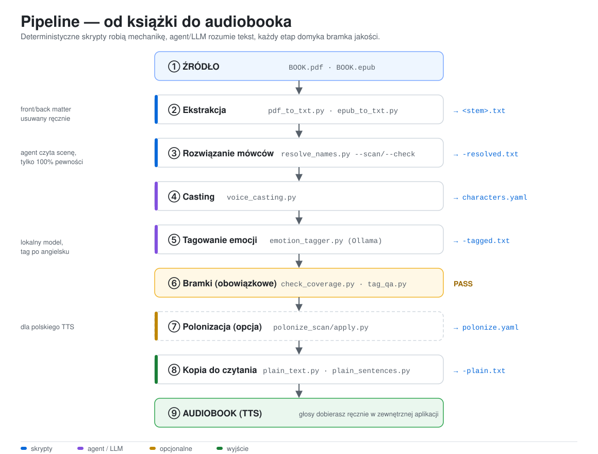
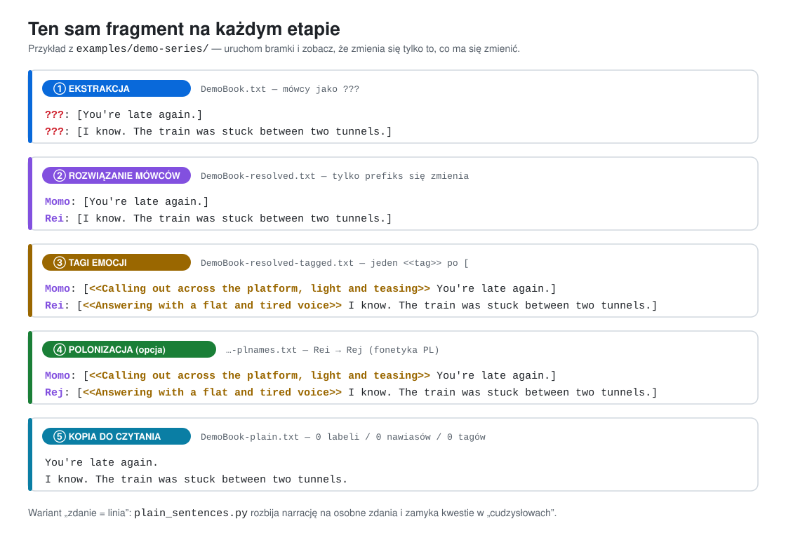
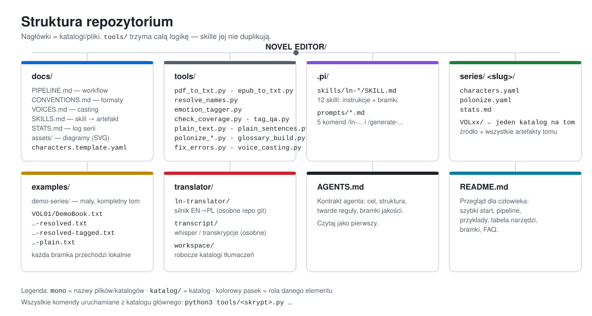
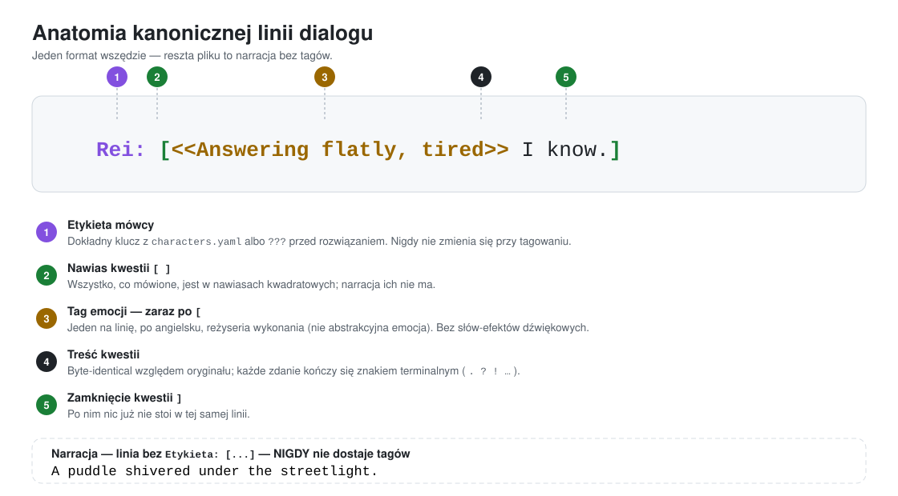
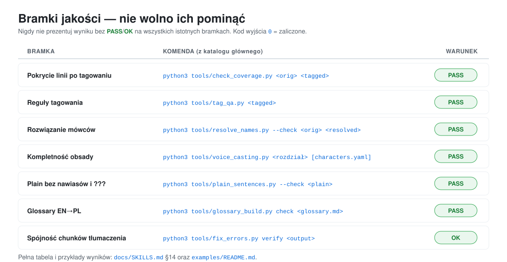
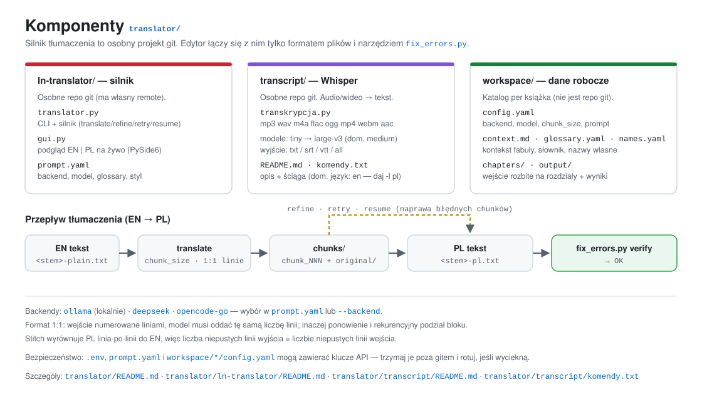

<p align="center">
  
</p>

<p align="center">
  
  
  
  
  
  
</p>

# NOVEL EDITOR

Warsztat do przygotowywania **light novel / web novel do audiobooka z wybranymi
postaciami i głosami**. Bierze surową książkę (**PDF** lub **EPUB**) i doprowadza ją
do zestawu plików gotowych pod syntezę mowy (TTS):

- **rozwiązani mówcy** (`???` → imię, tylko przy 100% pewności),
- **manifest obsady** (`characters.yaml`: etykiety, aliasy, rejestr głosu),
- **tagi emocji** `<<...>>` dopasowane do postaci (lokalny LLM, bez chmury),
- **polonizacja imion** (EN → PL fonetycznie, dla polskiego TTS),
- **czysta kopia do czytania** (zero labeli, nawiasów i tagów),
- opcjonalnie **glossary EN→PL** i **tłumaczenie** przez dołączony silnik.

> **Filozofia.** Deterministyczne skrypty robią mechanikę, agent/LLM robi **tylko**
> to, co wymaga rozumienia tekstu (kto mówi, jak brzmi kwestia), a **każdy etap
> domyka bramka jakości**, której nie wolno pominąć. Głosy dobierasz ręcznie w
> zewnętrznej aplikacji [**Audiobook-maker-v0.1**](https://github.com/kmk00/Audiobook-maker-v0.1)
> — dlatego repo **nie trzyma żadnych sampli ani plików audio**.

---

## Spis treści

| | |
|---|---|
| [1. Jak to działa](#1-jak-to-działa) | [8. Format kanoniczny](#8-format-kanoniczny-tekstu) |
| [2. Wymagania](#2-wymagania-i-instalacja) | [9. Bramki jakości](#9-bramki-jakości) |
| [3. Szybki start](#3-szybki-start) | [10. Tagowanie emocji](#10-tagowanie-emocji-lokalny-llm) |
| [4. Struktura repo](#4-struktura-repozytorium) | [11. Casting i głosy](#11-casting-i-głosy) |
| [5. Pipeline krok po kroku](#5-pipeline-krok-po-kroku) | [12. Polonizacja i glossary](#12-polonizacja-imion-i-glossary) |
| [6. Komendy i prompty](#6-komendy-i-prompty) | [13. Tłumaczenie EN→PL](#13-tłumaczenie-enpl) |
| [7. Narzędzia](#7-narzędzia-tools) | [14. Przykład end-to-end](#14-przykład-end-to-end) |

---

## 1. Jak to działa

<p align="center">
  
</p>

Ten sam fragment tekstu przechodzi przez każdy etap — i zmienia się **tylko to, co
ma się zmienić**:

<p align="center">
  
</p>

Dwie ścieżki spotykają się na końcu:

```
A) OBRÓBKA (EN lub PL)                          B) TŁUMACZENIE EN→PL
   PDF/EPUB ──ekstrakcja──▶ <stem>.txt              EN txt ──translator──▶ <stem>-pl.txt
        │                                                 │
        ├─ rozwiązanie mówców ─▶ -resolved.txt             └─ fix_errors.py verify (bramka)
        │        │
        │        └─ casting ─▶ characters.yaml
        │                 │
        │                 └─ tagowanie emocji ─▶ -tagged.txt
        │                          │
        │                          └─ check_coverage.py + tag_qa.py (bramki → PASS)
        │
        ├─ polonizacja imion ─▶ polonize.yaml + *-plnames.txt
        └─ plain copy ─▶ -plain.txt  (kopia do czytania)
```

**Trzy drogi na skróty** (bez obsady i tagów): `/ln-to-plain-txt-only` (PDF/EPUB →
plain, zdanie = linia), `/ln-pdf-to-plain` (PDF → plain, akapit = linia) oraz
`/ln-generate-full` (cała książka w komplecie, jedna komenda).

---

## 2. Wymagania i instalacja

| Wymaganie | Wersja | Do czego |
|---|---|---|
| **Python** | 3.10+ | wszystkie skrypty w `tools/` — **wyłącznie biblioteka standardowa** |
| **Ollama** | dowolna | tagowanie emocji (domyślny model `huihui_ai/gemma-4-abliterated:26b`) |
| **poppler-utils** (`pdftotext`) | — | ekstrakcja z PDF |
| **uv** | — | silnik tłumaczenia `translator/ln-translator/` |
| *(opcjonalnie)* **PyYAML** | — | `polonize_apply.py` (jest fallback bez PyYAML) |

```bash
# 1. sklonuj repozytorium
git clone https://github.com/kmk00/novel-editor-agentic-workspace.git
cd novel-editor-agentic-workspace

# 2. Ollama + model do tagowania emocji
ollama pull huihui_ai/gemma-4-abliterated:26b

# 3. (opcjonalnie) narzędzia systemowe
sudo apt install poppler-utils        # Debian/Ubuntu
# brew install poppler                # macOS
```

Nic nie trzeba instalować w Pythonie — `tools/` to czysty stdlib.

---

## 3. Szybki start

Najprostsza droga — **jedna komenda na całą książkę**:

```
/ln-generate-full "series/moja-seria/VOL01/Moja Ksiazka.epub"
/ln-generate-full "series/moja-seria/VOL01/Moja Ksiazka.pdf"
```

Komenda prowadzi cały łańcuch i zatrzymuje się na każdej bramce:

```
ekstrakcja → mówcy → characters.yaml → tagi emocji → check_coverage + tag_qa → plain copy
```

Na końcu drukuje **tabelę podsumowania** z licznikami i wynikiem każdej bramki.

**Tylko czytanie, bez TTS?** Dwie lżejsze komendy:

```
/ln-to-plain-txt-only "ksiazka.epub"    # plain, zdanie/kwestia = linia, kwestie w „cudzysłowach”
/ln-pdf-to-plain      "ksiazka.pdf"     # plain, akapit = linia (tylko PDF)
```

Punkt wejścia dla agenta i dla człowieka: **[`AGENTS.md`](AGENTS.md)** — kontrakt
(cel, struktura, twarde reguły, bramki). Szczegóły: [`docs/`](docs/).

---

## 4. Struktura repozytorium

<p align="center">
  
</p>

| Ścieżka | Co tam jest |
|---|---|
| [`AGENTS.md`](AGENTS.md) | kontrakt agenta — czytaj pierwszy |
| [`README.md`](README.md) | ten plik: przegląd dla człowieka |
| [`docs/PIPELINE.md`](docs/PIPELINE.md) | workflow krok po kroku + komendy |
| [`docs/CONVENTIONS.md`](docs/CONVENTIONS.md) | **źródło prawdy**: układ katalogów, nazwy plików, format tekstu i tagów |
| [`docs/VOICES.md`](docs/VOICES.md) | manifest obsady `characters.yaml` |
| [`docs/SKILLS.md`](docs/SKILLS.md) | co generuje który skill — z przykładami wejścia/wyjścia |
| [`docs/STATS.md`](docs/STATS.md) | log serii (`series/<slug>/stats.md`) |
| [`docs/characters.template.yaml`](docs/characters.template.yaml) | szablon manifestu obsady |
| [`tools/`](tools/) | **cała logika** — skille jej nie duplikują |
| [`examples/`](examples/) | mały, uruchamialny tom (wszystkie bramki przechodzą) |
| [`.pi/skills/`](.pi/skills/) | 12 skilli `ln-*` (instrukcje + bramki) |
| [`.pi/prompts/`](.pi/prompts/) | 5 komend `/...` |
| [`series/`](series/README.md) | dane serii: `characters.yaml`, `polonize.yaml`, `stats.md` + **`VOLxx/`** |
| `translator/` | silnik tłumaczenia EN→PL + Whisper (zagnieżdżone repo git — patrz „Repozytoria zdalne” niżej) |

### Repozytoria zdalne (ekosystem)

Warsztat składa się z **trzech repozytoriów** na GitHubie (konto
[**kmk00**](https://github.com/kmk00)) — dwa są zagnieżdżone lokalnie, jedno jest w pełni
zewnętrzne:

| Repozytorium | Rola | Branch | W root repo? |
|---|---|---|---|
| [**ln-translator**](https://github.com/kmk00/ln-translator) | silnik tłumaczenia EN→PL (CLI + GUI, chunki, retry/resume) | `main` | ❌ osobne repo |
| [**transcript**](https://github.com/kmk00/transcript) | Whisper: audio/wideo → txt/srt/vtt | `master` | ❌ osobne repo |
| [**Audiobook-maker-v0.1**](https://github.com/kmk00/Audiobook-maker-v0.1) | aplikacja webowa TTS (podział na role, OmniVoice) — **syntezuje audio z naszych artefaktów** | `master` | ❌ zewnętrzne (nie klonowane tutaj) |

Podział pracy: **to repo** produkuje tekst gotowy pod TTS
(`<stem>-resolved-tagged.txt`, `-tagged-plnames.txt`), **Audiobook-maker** robi z niego
audio. Dlatego tutaj nie ma ani kodu syntezy, ani sampli głosów. Szczegóły ekosystemu:
[`translator/README.md`](translator/README.md) §„Ekosystem”.

**Jeden katalog na tom.** Każdy tom ma własny `series/<slug>/VOLxx/` ze źródłem i
**wszystkimi** artefaktami; pliki wspólne (`characters.yaml`, `polonize.yaml`,
`stats.md`) zostają na poziomie serii. Szczegóły: [`docs/CONVENTIONS.md` §1a](docs/CONVENTIONS.md).

```
series/moja-seria/
├── characters.yaml                 # JEDEN na serię (po angielsku; tylko polonize po polsku)
├── polonize.yaml                   # mapa EN→PL (wspólna dla serii)
├── stats.md                        # JEDEN log serii (wszystkie tomy)
└── VOL01/
    ├── Moja Ksiazka.epub           # źródło tomu
    ├── Moja Ksiazka.txt            # ① ekstrakcja (mówcy ??? lub z EPUB)
    ├── Moja Ksiazka-resolved.txt   # ② ??? → imię
    ├── Moja Ksiazka-resolved-tagged.txt        # ③ tagi <<...>>
    ├── Moja Ksiazka-resolved-tagged.cache.json #    (cache, odtwarzalny)
    └── Moja Ksiazka-plain.txt      # ④ kopia do czytania
```

---

## 5. Pipeline krok po kroku

Wszystkie komendy uruchamiaj z **katalogu głównego** repo. `<slug>` to nazwa serii
(np. `moja-seria`).

### Krok 1 — Ekstrakcja (`ln-pdf-to-txt` / `epub_to_txt.py`)

```bash
# PDF — wszyscy mówcy anonimizowani do ??? (celowo: rozwiązanie to osobny krok)
python3 tools/pdf_to_txt.py "series/<slug>/VOLxx/BOOK.pdf" "series/<slug>/VOLxx/<stem>.txt"

# EPUB — etykiety mówców zwykle są w źródle i zostają zachowane
python3 tools/epub_to_txt.py "series/<slug>/VOLxx/BOOK.epub"
```

Po PDF **obowiązkowy ręczny review**: usuń front/back matter, popraw artefakty
reflow, nadaj nagłówkom kropki (`CHAPTER X. NAME.`), upewnij się, że każde zdanie
ma znak końcowy.

**Wynik** (`<stem>.txt`) — kanoniczny format rozdziału:

```
The rain had stopped by the time Rei reached the station.

???: [You're late again.]

???: [I know. The train was stuck between two tunnels.]

A puddle shivered under the streetlight.

CHAPTER ONE. THE LATE TRAIN.
```

> `???` jest **celowe** — PDF gubi nazwy mówców, więc rozwiązanie to osobny,
> świadomy krok. EPUB zostawia większość etykiet, więc `???` jest tam mało.

### Krok 2 — Rozwiązanie mówców (`ln-speaker-resolution`)

Mówców rozwiązuje **agent** (nie model lokalny): czyta scenę i przypisuje imię
**tylko przy 100% pewności** — na podstawie narracji, przedstawienia się, zwrotu
po imieniu, jednoznacznej roli albo jednoznacznej alternacji w małej scenie.

```bash
# skan: wypisz wszystkie linie ??? z kontekstem
python3 tools/resolve_names.py --scan "series/<slug>/VOLxx/<stem>.txt"

# ... agent edytuje plik (zmienia się TYLKO prefiks ???:) ...

# BRAMKA: tylko prefiksy mówców mogą się zmienić
python3 tools/resolve_names.py --check \
    "series/<slug>/VOLxx/<stem>.txt" "series/<slug>/VOLxx/<stem>-resolved.txt"
```

**Przykład:**

```
???: [You're late again.]                      →  Momo: [You're late again.]
???: [I know. The train was stuck …]            →  Rei:  [I know. The train was stuck …]
???: [Muttered a voice from the crowd.]         →  ???:  [Muttered a voice from the crowd.]   (brak kotwicy → zostaje)
```

Bramka na przykładzie demo:

```
PASS: 3 '???' speaker(s) resolved, all other lines byte-identical.
  line 3: ??? -> Momo  [[You're late again.]...]
  line 5: ??? -> Rei  [[I know. The train was stuck between two tunnels.]...]
  line 9: ??? -> Momo  [[Then stop blaming the train.]...]
```

### Krok 3 — Casting (`ln-voice-casting`)

```bash
cp -n docs/characters.template.yaml "series/<slug>/characters.yaml"   # tylko jeśli brak
python3 tools/voice_casting.py \
    "series/<slug>/VOLxx/<stem>-resolved.txt" "series/<slug>/characters.yaml"
```

Uzupełniaj `MISSING FROM CAST`, aż będzie `PASS`:

```
Speakers: 2 distinct, 4 dialogue lines

CAST:
  Momo                            3 lines
  Rei                             1 lines

PASS: every named speaker is cast.
```

### Krok 4 — Tagowanie emocji (`ln-emotion-tagging`)

```bash
python3 tools/emotion_tagger.py \
    "series/<slug>/VOLxx/<stem>-resolved.txt" \
    --cast "series/<slug>/characters.yaml"
# → series/<slug>/VOLxx/<stem>-resolved-tagged.txt (+ .cache.json)
```

**Przykład:**

```
Momo: [You're late again.]
   ↓
Momo: [<<Calling out across the platform, light and teasing>> You're late again.]

Rei: [U-Uh…]
   ↓
Rei: [<<Stuttering, soft and slow>> Uh…]
```

Długie książki uruchamiaj w tle z logiem (re-runy są tanie dzięki cache):

```bash
nohup python3 tools/emotion_tagger.py "series/<slug>/VOLxx/<stem>-resolved.txt" \
    --cast "series/<slug>/characters.yaml" > /tmp/tag_<stem>.log 2>&1 &
```

### Krok 5 — Bramki po tagowaniu (**obowiązkowe**)

```bash
python3 tools/check_coverage.py \
    "series/<slug>/VOLxx/<stem>-resolved.txt" \
    "series/<slug>/VOLxx/<stem>-resolved-tagged.txt"     # MUST be PASS

python3 tools/tag_qa.py "series/<slug>/VOLxx/<stem>-resolved-tagged.txt"   # MUST be PASS
```

```
PASS — every readable line of the original is present, none deleted, all changes within the allowed set.
PASS — all tagging rules satisfied
```

### Krok 6 — Kopia do czytania (`ln-plain-copy`)

```bash
python3 tools/plain_text.py \
    "series/<slug>/VOLxx/<stem>-resolved-tagged.txt" \
    "series/<slug>/VOLxx/<stem>-plain.txt"
```

```
Momo: [<<Calling out across the platform, light and teasing>> You're late again.]
   ↓
You're late again.
```

Wariant „zdanie = linia” (`ln-to-plain-txt-only`) rozbija dodatkowo narrację i
zamyka kwestie w cudzysłowach:

| Przed (`<stem>.txt`) | Po (`<stem>-plain.txt`) |
|---|---|
| `???: [Welcome home, onii-sama!]` | `“Welcome home, onii-sama!”` |
| `Narration with two sentences. Second one here.` | `Narration with two sentences.`<br>`Second one here.` |
| `<Komari: You're early.>` | `(Komari: You're early.)` |
| `<<Exclaiming brightly>> Hello!` | `Hello!` (tag usunięty) |

### Krok 7 — Polonizacja (opcjonalnie, dla polskiego TTS)

```bash
python3 tools/polonize_scan.py "series/<slug>/VOLxx/<stem>-resolved-tagged.txt" > /tmp/candidates.txt
# zbuduj/uzupełnij series/<slug>/polonize.yaml
python3 tools/polonize_apply.py \
    "series/<slug>/VOLxx/<stem>-resolved-tagged.txt" \
    "series/<slug>/polonize.yaml" \
    "series/<slug>/VOLxx/<stem>-resolved-tagged-plnames.txt"
```

---

## 6. Komendy i prompty

Komendy to prompty w `.pi/prompts/` — każda odwołuje się do odpowiedniego skilla
i kończy **tabelą podsumowania**.

| Komenda | Argument | Co robi |
|---|---|---|
| `/ln-generate-full` | `"<książka.pdf\|.epub>" [katalog tomu]` | **one-shot**: ekstrakcja → mówcy → `characters.yaml` → tagi → bramki → plain copy |
| `/ln-to-plain-txt-only` | `"<książka.pdf\|.epub>" [katalog tomu]` | one-shot **tylko plain**: zdanie/kwestia = linia, bez `???`/labeli/nawiasów |
| `/ln-pdf-to-plain` | `"<książka.pdf>"` | one-shot PDF → plain (akapit = linia) |
| `/generate-glossary` | `"<plik plain lub katalog tomu>"` | buduje `glossary.md` (EN→PL) + blok YAML do `prompt.yaml` |
| `/ln-fix-translation` | `"<plik PL .txt lub katalog output/...>"` | `detect → poprawa → verify → stitch` + raport `.md` |

Przykład:

```
/ln-generate-full "series/moja-seria/VOL01/Moja Ksiazka.epub"
```

---

## 7. Narzędzia (`tools/`)

Wszystkie skrypty uruchamiane z katalogu głównego: `python3 tools/<skrypt>.py …`.
**Tylko biblioteka standardowa** (poza opcjonalnym PyYAML).

| Skrypt | Co robi | Skill / komenda |
|---|---|---|
| `pdf_to_txt.py` | PDF → kanoniczny TXT; dialogi jako `???: [...]`, usuwa junk/URL-e/stopki/nagłówki | `ln-pdf-to-txt` |
| `epub_to_txt.py` | EPUB → kanoniczny TXT; **zachowuje etykiety mówców**, normalizuje nagłówki, raportuje anomalie | `ln-generate-full`, `ln-to-plain-txt-only` |
| `resolve_names.py` | `--scan` kontekstów `???`; `--check` bramka (zmienia się tylko prefiks mówcy) | `ln-speaker-resolution` |
| `resolve_speakers_llm.py` | *last-resort*: pyta lokalny model o mówcę (domyślnie **nie używać** — agent jest dokładniejszy) | `ln-speaker-resolution` |
| `voice_casting.py` | skan mówców vs `characters.yaml` → `CAST` / `???` / `MISSING` | `ln-voice-casting` |
| `emotion_tagger.py` | lokalny LLM (Ollama) → walidacja → inline `<<tag>>`; cache per linia | `ln-emotion-tagging` |
| `tag_qa.py` | QA reguł tagowania (1 tag/linia, EN, 4–24 słowa, ≤1 przecinek, brak słów-efektów) | `ln-emotion-tagging` |
| `check_coverage.py` | **bramka pokrycia** orig↔tagged (żadna czytelna linia nie zniknęła) | `ln-tag-coverage-check` |
| `plain_text.py` | tagged → plain (akapit = linia; `<...>` → `()`; usuwa labelki/tagi) | `ln-plain-copy` |
| `plain_sentences.py` | kanoniczny → plain **zdanie = linia**, kwestie w „cudzysłowach”, `--check` bramka | `ln-to-plain-txt-only` |
| `polonize_scan.py` | skan kandydatów na nazwy własne (z licznikami) | `ln-name-polonization` |
| `polonize_apply.py` | nakłada mapę EN→PL (całe słowa, zachowanie wielkości liter) | `ln-name-polonization` |
| `glossary_build.py` | `scan` → `glossary.md` (EN→PL + blok YAML); `check` → bramka | `ln-generate-glossary` |
| `fix_errors.py` | `detect` / `verify` / `stitch` błędnych chunków tłumaczenia + raport | `ln-translation-error-check` |
| `log_stats.py` | dopisuje wiersz do `series/<slug>/stats.md` | wszystkie skille |
| `legacy/apply_speaker_map.py` | *(wycofany)* nakładał mapę `linia → mówca`; zastąpiony edycją w `ln-speaker-resolution` | — |

### Skille (`.pi/skills/`)

| Skill | Rola |
|---|---|
| `ln-generate-full` | one-shot dla jednej książki (PDF/EPUB) + wszystkie bramki |
| `ln-pdf-to-txt` | PDF → `<stem>.txt` (`???: [...]`) + czyszczenie junk/front/back matter |
| `ln-pdf-to-plain-redacted` | one-shot PDF → plain (akapit = linia) |
| `ln-to-plain-txt-only` | one-shot PDF/EPUB → **tylko plain** (zdanie = linia, zero `<>`) |
| `ln-speaker-resolution` | `???` → imię (tylko 100% pewności) |
| `ln-voice-casting` | `characters.yaml`: etykiety, aliasy, `register`, `polonize` |
| `ln-emotion-tagging` | tagi `<<...>>` w dialogach (kanoniczny format, TTS-safe) |
| `ln-tag-coverage-check` | bramka: żadna czytelna linia nie zniknęła |
| `ln-plain-copy` | wersja do czytania bez labeli/nawiasów/tagów |
| `ln-name-polonization` | EN→PL fonetyczna polonizacja imion + deklinacja |
| `ln-generate-glossary` | `glossary.md` dla tomu + blok do `prompt.yaml` |
| `ln-translation-error-check` | naprawa błędnych chunków tłumaczenia + raport `.md` |

> **EPUB** nie ma osobnego skilla — obsługuje go `tools/epub_to_txt.py` w ramach
> `ln-generate-full` / `ln-to-plain-txt-only`.

---

## 8. Format kanoniczny tekstu

<p align="center">
  
</p>

```
NARRACYJNY AKAPIT — jedna linia, bez tagów i bez labeli.

Imię: [<<Dyrektywa wykonania>> Treść kwestii…]

???: [Kwestia nierozwiązanego mówcy.]

<Linia systemowa / transmisja>

ROZDZIAŁ PIERWSZY.
```

- **Dialog** = `Etykieta: [treść]`; etykieta to mówca albo `???`.
- **Narracja** = linia bez `Etykieta: [...]` — *nigdy* nie dostaje tagów.
- **Tag emocji** = inline `<<...>>` **zaraz po `[`**, po angielsku, jeden na linię,
  bez słów-efektów dźwiękowych, maks. jeden przecinek.
- **Nagłówki** (`PROLOGUE.`, `CHAPTER 1. NAME.`, `EPILOGUE. NAME.`) — osobna linia, z kropką.
- Dokładnie jedna pusta linia między blokami; każde zdanie kończy się znakiem
  terminalnym (`.`, `?`, `!`, `…`).
- **TTS-safety:** w plikach kanonicznych/tagged zero surowych `<<`/`>>` poza tagami;
  w plikach **plain/do syntezy zero jakichkolwiek nawiasów kątowych** — `<...>` i
  `<<...>>` zamień na `()` (surowy `<>` psuje TTS).

### Nazewnictwo plików

| Przyrostek | Znaczenie | Skill |
|---|---|---|
| `<stem>.txt` | tekst wejściowy, mówcy `???: [...]` lub już nazwani | `ln-pdf-to-txt` / `epub_to_txt.py` |
| `<stem>-resolved.txt` | `???` → `Imię` | `ln-speaker-resolution` |
| `<stem>-resolved-tagged.txt` | tagi emocji `<<...>>` | `ln-emotion-tagging` / `ln-generate-full` |
| `<stem>-plain.txt` | czysty tekst do czytania | `ln-plain-copy` / `ln-to-plain-txt-only` |
| `<stem>-plnames.txt` | polonizacja imion (`ln-generate-full`: `-polonized.txt`) | `ln-name-polonization` |
| `glossary.md` | glossary tłumaczeniowy EN→PL dla tomu | `ln-generate-glossary` |
| `<stem>-pl.txt` | tłumaczenie polskie | `translator/ln-translator` |

---

## 9. Bramki jakości

<p align="center">
  
</p>

| Bramka | Komenda | Warunek |
|---|---|---|
| Pokrycie linii po tagowaniu | `python3 tools/check_coverage.py <orig> <tagged>` | `PASS` |
| Reguły tagowania | `python3 tools/tag_qa.py <tagged>` | `PASS` |
| Rozwiązanie mówców | `python3 tools/resolve_names.py --check <orig> <resolved>` | `PASS` |
| Kompletność obsady | `python3 tools/voice_casting.py <rozdział> [characters.yaml]` | `PASS` |
| Plain bez nawiasów i `???` | `python3 tools/plain_sentences.py --check <plain>` | `PASS` |
| Glossary EN→PL | `python3 tools/glossary_build.py check <glossary.md>` | `PASS` |
| Spójność chunków tłumaczenia | `python3 tools/fix_errors.py verify <output>` | `OK` |

**Nigdy nie prezentuj wyniku bez `PASS`/`OK` na wszystkich istotnych bramkach.**

---

## 10. Tagowanie emocji (lokalny LLM)

```bash
python3 tools/emotion_tagger.py "<stem>-resolved.txt" \
    --cast "series/<slug>/characters.yaml" \
    [--model NAME] [--context N] [--limit N] [--keep-stutters] [--verbose]
```

- **Domyślny model:** `huihui_ai/gemma-4-abliterated:26b` z `"think": false`.
  Modele rozumujące **muszą** mieć wyłączone myślenie — inaczej palą budżet tokenów
  i zwracają pusty JSON, a wszystko spada na fallback.
- Tagi są **zawsze po angielsku**: krótka reżyseria *delivery + audible traits
  [+ „as if …”]*, a nie abstrakcyjne etykiety (`<<Angry>>` ❌).
- Przepustowość: **~1.5–2 s / linia dialogowa** (na domyślnym modelu).
- **Cache** (`*.cache.json`) czyni re-runy tanimi i odtwarzalnymi; można go usunąć.
- Tagger normalizuje stuttery (`A-are` → `Are` + `<<Stuttering>>`), ucina myślenie
  po myślnikach, dodaje `…`, usuwa linie nieczytelne.

Przykład (książka, nie demo):

```
Elsa:    [<<Drawing out the words slowly and low, with a predatory curiosity>> …Ah, were you asking me?]
Wilhelm: [<<Asking with sharp evenness and loud clarity, as if questioning a lack of relevance>> What does the Zergev Corps have to do with this right now?]
```

---

## 11. Casting i głosy

`series/<slug>/characters.yaml` — **jeden na serię**, po angielsku (tylko `polonize`
po polsku). **Głosy dobierasz ręcznie** w zewnętrznej aplikacji TTS
([Audiobook-maker-v0.1](https://github.com/kmk00/Audiobook-maker-v0.1)) — dlatego
`characters.yaml` **nie ma** pól `voice`/`sample`.

```yaml
series: demo-series

narrator:
  register: "calm, literary, medium pace"

characters:
  Rei:
    polonize: Rej
    aliases: [Rei-kun]
    register: "quiet, guarded, short clipped sentences"

  Momo:
    polonize: Momo
    aliases: [Momo-chan]
    register: "warm, teasing, quick to laugh"
```

| Pole | Znaczenie |
|---|---|
| klucz pod `characters:` | **dokładna etykieta mówcy z tekstu** (`Rei:`) |
| `aliases` | inne etykiety tej samej postaci (imiona, przezwiska, callsigny) |
| `polonize` | forma, którą ma wymówić polski TTS (spójna z `polonize.yaml`) |
| `register` | krótki opis barwy/tempa **po angielsku** — kontekst dla tagów emocji |

Weryfikacja i checklista: [`docs/VOICES.md`](docs/VOICES.md) + skill `ln-voice-casting`.

---

## 12. Polonizacja imion i glossary

### Polonizacja (dla polskiego TTS)

Zamienia angielskie nazwy na fonetykę polską, z zachowaniem wielkości liter i
possessivów (`Beatrice → Beatris`, `Undertaker → Andertejker`, `Beatrice's → Beatris's`).

```bash
python3 tools/polonize_scan.py "<stem>-tagged.txt"      # kandydaci → /tmp/candidates.txt
# ... budujesz series/<slug>/polonize.yaml ...
python3 tools/polonize_apply.py "<stem>-tagged.txt" "series/<slug>/polonize.yaml" "<stem>-plnames.txt"
# potem ręczny pass deklinacji (skill ln-name-polonization)
```

Przykład `polonize.yaml`:

```yaml
"Rei": "Rej"
"Beatrice": "Beatris"
"Undertaker": "Andertejker"
```

### Glossary tłumaczeniowy EN→PL

```bash
python3 tools/glossary_build.py scan "series/<slug>/VOLxx/<stem>-plain.txt" \
    --slug "<slug>" --volume VOLxx --min-count 2 \
    --characters "series/<slug>/characters.yaml" \
    --polonize   "series/<slug>/polonize.yaml"

# agent uzupełnia PL + Typ, potem:
python3 tools/glossary_build.py check "series/<slug>/VOLxx/glossary.md"    # PASS
```

Gotowy blok kopiujesz do `translator/ln-translator/prompt.yaml` → `glossary:`:

```yaml
glossary:
  "Rias Gremory": "Rias Gremory"
  "Sacred Gear": "Święty Element"
  "Fallen Angel": "Upadły Anioł"
```

---

## 13. Tłumaczenie EN→PL

<p align="center">
  
</p>

`translator/` to **trzy osobne komponenty** (nie część kodu edytora) — szczegóły:
[`translator/README.md`](translator/README.md).

| Komponent | Co to | Repo zdalne |
|---|---|---|
| `ln-translator/` | **silnik EN→PL** (CLI + GUI, chunki, 1:1, retry/resume) | [github.com/kmk00/ln-translator](https://github.com/kmk00/ln-translator) (`main`) |
| `transcript/` | **Whisper** — audio/wideo → txt/srt/vtt ([`README.md`](translator/transcript/README.md) + ściąga [`komendy.txt`](translator/transcript/komendy.txt); dom. język `en`) | [github.com/kmk00/transcript](https://github.com/kmk00/transcript) (`master`) |
| `workspace/` | **dane robocze** per książka: `config.yaml`, `context.md`, `glossary.yaml`, `names.yaml`, `chapters/`, `output/` | ❌ (dane + klucze API — `.gitignore`) |

Czwarty, **zewnętrzny** element ekosystemu to
[**Audiobook-maker-v0.1**](https://github.com/kmk00/Audiobook-maker-v0.1) — aplikacja
webowa TTS (OmniVoice), w której ręcznie przypisujesz głosy i generujesz audiobooka.
To tam trafiają pliki z kroków ①–④; to repo nie zawiera jej kodu.

Silnik: [`translator/`](translator/README.md) (Ollama lub DeepSeek;
konfiguracja w `prompt.yaml`).

**Transkrypcja nagrań** (osobne narzędzie, nie część pipeline'u):

```bash
cd translator/transcript
uv sync                                          # wymaga też ffmpeg w PATH
uv run transkrypcja.py <plik_lub_folder> -l pl --format txt
```

Domyślny język to **angielski** — dla polskiego nagrania zawsze podaj `-l pl`
(albo `--lang auto`). Opis: [`transcript/README.md`](translator/transcript/README.md),
ściąga komend: [`transcript/komendy.txt`](translator/transcript/komendy.txt).

```bash
cd translator/ln-translator
uv run translator translate <plik_EN.txt> -o output/<nazwa>_pl.txt
uv run translator refine    output/<nazwa>_pl.txt -e <plik_EN.txt>
uv run translator diagnose  output/<nazwa>_pl.txt
uv run translator retry     output/<nazwa>_pl.txt          # regeneracja wadliwych chunków
```

Gdy w pliku pojawią się markery `[BŁĄD TŁUMACZENIA — CHUNK N]`:

```bash
python3 tools/fix_errors.py detect <output.txt>   # które chunki i dlaczego
# poprawa: /ln-fix-translation  (agent odtwarza PL 1:1 z EN) albo `translator retry`
python3 tools/fix_errors.py verify <output.txt>   # musi być OK
python3 tools/fix_errors.py stitch <output.txt>   # zszycie + <stem>_FIX_raport.md
```

> 🔐 **Klucze API:** `ln-translator/.env`, `ln-translator/prompt.yaml` i
> `workspace/*/config.yaml` mogą zawierać klucze w plaintekście. Trzymaj je poza
> gitem; jeśli taki klucz trafi kiedykolwiek do historii gita, **zrotuj go**. Szczegóły:
> [`translator/README.md`](translator/README.md).

Układ plików tłumaczenia:

```
output/<Book>-plain_pl_<ts>/
├── <Book>-plain_pl_<ts>.txt      # wynik (zszyty)
├── errors.md                     # raport wykrytych błędów
└── chunks/
    ├── chunk_NNN.txt             # PL (niektóre z markerem błędu)
    ├── original/chunk_NNN.txt    # EN — wzorzec (NIE ruszać)
    └── session.json              # total_chunks, overlap, failed_chunks
```

**Format 1:1.** Źródła `-plain.txt` są „zdanie = linia”, więc silnik wymusza jedną
linię wyjścia na jedną linię wejścia (numerowanie wejścia + twarde polecenie liczby
linii, ponowienia, rekurencyjny podział bloku). Stitch składa PL liniowo względem
źródła EN, więc liczba niepustych linii wyjścia = liczbie niepustych linii wejścia.

---

## 14. Przykład end-to-end

W [`examples/demo-series/`](examples/) leży mały, kompletny tom (tekst oryginalny),
na którym **wszystkie bramki przechodzą**. Możesz to sprawdzić bez pobierania niczego:

```bash
python3 tools/resolve_names.py --check examples/demo-series/VOL01/DemoBook.txt \
                                      examples/demo-series/VOL01/DemoBook-resolved.txt
python3 tools/voice_casting.py        examples/demo-series/VOL01/DemoBook-resolved.txt \
                                      examples/demo-series/characters.yaml
python3 tools/check_coverage.py       examples/demo-series/VOL01/DemoBook-resolved.txt \
                                      examples/demo-series/VOL01/DemoBook-resolved-tagged.txt
python3 tools/tag_qa.py               examples/demo-series/VOL01/DemoBook-resolved-tagged.txt
python3 tools/plain_sentences.py      examples/demo-series/VOL01/DemoBook.txt /tmp/d.txt
python3 tools/plain_sentences.py --check /tmp/d.txt
```

Wynik (realny, `exit 0` na każdej):

```
PASS: 3 '???' speaker(s) resolved, all other lines byte-identical.
PASS: every named speaker is cast.
PASS — every readable line of the original is present, none deleted…
PASS — all tagging rules satisfied
PASS — no labels/???/tags, every line terminal-punctuated.
```

Ten sam fragment przez cały łańcuch — patrz obrazek w [sekcji 1](#1-jak-to-działa)
oraz [`examples/README.md`](examples/README.md).

### Use case'y

| Scenariusz | Komenda / kroki |
|---|---|
| **Nowa książka (EPUB) w komplecie** | `/ln-generate-full "series/<slug>/VOLxx/<Book>.epub"` |
| **Nowa książka (PDF) w komplecie** | `/ln-generate-full "series/<slug>/VOLxx/<Book>.pdf"` (PDF → dużo `???`) |
| **Szybka kopia do czytania** | `/ln-to-plain-txt-only "book.pdf\|.epub"` albo `/ln-pdf-to-plain "book.pdf"` |
| **Tylko tagi emocji dla istniejącego rozdziału** | `emotion_tagger.py` + `check_coverage.py` + `tag_qa.py` |
| **Domknięcie nierozwiązanych `???`** | `resolve_names.py --scan` → decyzje agenta → `--check` |
| **Nowa obsada / aktualizacja `characters.yaml`** | `voice_casting.py` → uzupełnij → `PASS` |
| **Polski TTS (fonetyka imion)** | `polonize_scan.py` → `polonize.yaml` → `polonize_apply.py` |
| **Tłumaczenie tomu EN→PL** | `uv run translator translate …` → `diagnose` → `/ln-fix-translation` |
| **Naprawa błędnych chunków** | `/ln-fix-translation "<output .txt>"` |
| **Kontrola jakości przed oddaniem** | wszystkie bramki z [sekcji 9](#9-bramki-jakości) |

---

## 15. FAQ i pułapki

**Czym różni się PDF od EPUB?**
EPUB zwykle **zawiera etykiety mówców** (mało `???`). PDF **celowo anonimizuje
wszystkich** do `???` — wtedy `ln-speaker-resolution` to główna praca.

**Model taggera zwraca puste tagi / wszystko spada na fallback.**
To model rozumujący z włączonym myśleniem. Użyj domyślnego modelu albo **nie**
włączaj `--think`.

**Czy tagi mogą być polskie?**
Nie. Tagi są **zawsze po angielsku** (bramka `tag_qa.py` to sprawdza) — polonizacja
dotyczy tylko imion.

**Co zrobić, gdy nie wiem, kto mówi?**
Zostaw `???`. Reguła żelazna: **nie zgaduj mówcy.** Bramka `resolve_names.py --check`
i tak pilnuje, by zmienił się wyłącznie prefiks.

**Czy mogę usunąć `*.cache.json`?**
Tak — to tylko cache tagów. Kolejny re-run go odtworzy.

**Dlaczego w pliku plain nie ma `<...>`?**
Bo surowy nawias kątowy psuje TTS. `plain_text.py` / `plain_sentences.py` zamieniają
`<...>` i `<<...>>` na `(...)`.

**Czy mogę edytować `tools/legacy/`?**
To skrypty wycofane — nie linkuj ich ze skilli. Zobacz
[`tools/legacy/README.md`](tools/legacy/README.md).

**Gdzie jest log wykonanej pracy?**
Jeden na serię: `series/<slug>/stats.md` (format: [`docs/STATS.md`](docs/STATS.md)),
dopisywany przez `tools/log_stats.py`.

---

## 16. Dokumentacja

| Dokument | Zawartość |
|---|---|
| [`AGENTS.md`](AGENTS.md) | kontrakt agenta: cel, struktura, twarde reguły, bramki |
| [`docs/PIPELINE.md`](docs/PIPELINE.md) | workflow krok po kroku + komendy |
| [`docs/CONVENTIONS.md`](docs/CONVENTIONS.md) | układ katalogów, nazwy plików, kanoniczny format |
| [`docs/SKILLS.md`](docs/SKILLS.md) | co generuje który skill (z przykładami) |
| [`docs/VOICES.md`](docs/VOICES.md) | manifest obsady |
| [`docs/STATS.md`](docs/STATS.md) | log serii |
| [`examples/README.md`](examples/README.md) | uruchamialny przykład + bramki |

---

<p align="center">
  <sub>Zbudowane pod pipeline <b>light novel → audiobook TTS</b>. Głosy dobierasz ręcznie w
  <a href="https://github.com/kmk00/Audiobook-maker-v0.1">Audiobook-maker v0.1</a> —
  repo dostarcza tekst, obsadę i reżyserię emocji, nie dźwięk.</sub>
</p>
